# Practice App: Spaced-Repetition Music Practice

**Design document · v0.2 · 2026-11-23 · Option A implemented (app v0.1.1)**

A small offline web app that tells you **what to practice today** and remembers **how it went** (tempo, difficulty, when to practice next).
It is hosted as a static site on GitHub Pages from the `docs/` folder and installed on an iPhone with Safari's **Add to Home Screen**.

- Mockups: open [`mockups/index.html`](mockups/index.html) in a browser (4 options × 3 screens).
- Screenshots of every mockup are embedded in [§10](#10-ui-design-options-mockups).
- **Implementation:** Option A (Native iOS List) is built in [`../src`](../src) and compiled to [`../docs`](../docs). See the [README](../README.md) for build, test, and deploy steps.

> **Decisions since v0.1:** the 8+ streak must be **consecutive** (any lower rating resets it), the rating scale is 10 = best, and a desktop-only **Test mode** lets you simulate future dates ([§4.7](#47-test-mode-desktop-only)).

---

## Contents

1. [Goals and non-goals](#1-goals-and-non-goals)
2. [Requirements](#2-requirements)
3. [Decisions](#3-decisions)
4. [Scheduling (the recommendation engine)](#4-scheduling-the-recommendation-engine)
5. [Data model and storage](#5-data-model-and-storage)
6. [Architecture and tech stack](#6-architecture-and-tech-stack)
7. [iPhone Home Screen app details](#7-iphone-home-screen-app-details)
8. [Offline support and updates](#8-offline-support-and-updates)
9. [GitHub Pages deployment](#9-github-pages-deployment)
10. [UI design options (mockups)](#10-ui-design-options-mockups)
11. [Testing strategy](#11-testing-strategy)
12. [Roadmap](#12-roadmap)
13. [Suggestions for a music spaced-repetition app](#13-suggestions-for-a-music-spaced-repetition-app)
14. [Open questions](#14-open-questions)

---

## 1. Goals and non-goals

**Goals**

- Add custom practice tasks (a task is just a description).
- Log a practice session for a task: **tempo**, **difficulty rating**, and **days until next practice**.
- Recommend the next-practice interval: **next day while the task has fewer than 5 sessions rated 8+**, with longer intervals afterwards.
- Show the task's **recent history** (tempo and difficulty) on the logging screen.
- A **Today** queue of overdue and due tasks.
- Runs fully offline on an iPhone as a Home Screen app; no server, no account.

**Non-goals (for now)**

- Accounts, cloud sync, sharing, or multiple devices (backup/restore covers moving data).
- Audio recording or storing sheet music.
- Push notifications (these need a server; see [§7](#7-iphone-home-screen-app-details)).

## 2. Requirements

### Functional

| ID | Requirement | Priority |
|----|-------------|----------|
| F1 | Create, edit, archive, and delete tasks (description only). New tasks are due **today**. | ✅ v0.1 |
| F2 | **Today** view: overdue tasks first, then due today, then done today, then a short upcoming list. | ✅ v0.1 |
| F3 | **Log session**: tempo (BPM, optional), difficulty 1–10, next-practice days (prefilled with the recommendation, editable). | ✅ v0.1 |
| F4 | The log screen shows the **last N sessions** (date, tempo, rating, interval) plus a small tempo/rating chart, and "last" and "best" tempo. | ✅ v0.1 |
| F5 | The recommendation updates **live** as the rating changes and explains itself (e.g. "3 of 5 in a row at 8+"). | ✅ v0.1 |
| F6 | Edit or delete a session (recomputes the task's due date). | ✅ v0.1 |
| F7 | **Export** all data to a JSON file (iOS share sheet) and **import** it (replace or merge). Show a reminder when the last backup is old. | ✅ v0.1 |
| F8 | Works offline and installs as a Home Screen app (manifest, icons, service worker). | ✅ v0.1 |
| F9 | Settings to tune the scheduler (thresholds, growth, min/max interval). | ✅ v0.1 |
| F10 | Task detail page with full history and charts. | ✅ v0.1 |
| F11 | Built-in metronome and practice timer, with the metronome tempo logged automatically ("Practice Mode", Option B). | v0.3 |
| F12 | Session notes ✅; tags, target tempo, snooze/skip, calendar heatmap. | later |
| F13 | **Test mode (desktop only):** pick a simulated "today" with a calendar picker to see how the schedule plays out on future days. | ✅ v0.1 |
| F14 | **App icon badge** with the number of tasks due or overdue today (opt-in; needs notification permission on iPhone). | ✅ v0.1.1 |

### Non-functional

- **Fast:** first load under 100 KB gzipped; every interaction instant (all data is local).
- **One-handed:** tap targets ≥ 44 pt; logging takes ≤ 3 taps when the prefilled values are accepted.
- **Durable:** no data loss on app updates; versioned schema with migrations; easy backups.
- **Zero cost and zero ops:** static hosting only.
- **Accessible:** color is never the only signal (8+ uses both color and a number), supports dark mode and Dynamic Type.

## 3. Decisions

| # | Decision | Notes |
|---|------------|----------------|
| D1 | The rating is **1–10 where higher = better/easier** (10 = effortless, 1 = can't play it). "8+" means a good session. | The label defaults to "Difficulty" with the anchor "1 = can't play it · 10 = effortless"; Settings can switch it to "How did it go?". |
| D2 | **"5 sessions at 8+" must be consecutive.** Any session rated below 8 resets the streak to 0. Several 8+ sessions on the **same day** count once (setting: *One per day*). | Confirmed by you. Five good run-throughs in one evening aren't spaced practice. |
| D3 | The session being logged **counts** toward the streak. | The recommendation updates live: on the 5th consecutive good session the app recommends a longer gap immediately. |
| D4 | Tempo is **optional** per session. | Some tasks (ear training, sight-reading) have no meaningful BPM. |

## 4. Scheduling (the recommendation engine)

### 4.1 The rule

> Recommended time to next practice is **1 day** until the task has **5 consecutive sessions rated 8+**.

A task in this phase is **Learning**. Once the streak reaches 5 it **graduates**. A later session rated below 8 breaks the streak, and the task goes back to Learning (daily practice) until it has 5 in a row again.

### 4.2 After graduation

The interval grows from the gap you just practiced across. "Base" is the number of days since the previous session (minimum 1). If you practiced the task twice on the same day, the previous interval is used instead.

| Rating this session | Learning (streak < 5) | Graduated (streak ≥ 5) |
|---|---|---|
| **10** | 1 day | base × **2.5** |
| **9** | 1 day | base × **2.0** |
| **8** | 1 day | base × **1.5** |
| **1–7** | 1 day (streak resets) | 1 day (**reset** — back to Learning) |

Graduated results are rounded and clamped to **[2, 60] days**. Thresholds, growth factors, and limits are all adjustable in Settings. Basing growth on *actual* elapsed days rewards remembering a piece after a longer-than-planned gap, and is conservative when you practice early.

### 4.3 Implementation ([`src/domain/scheduler.ts`](../src/domain/scheduler.ts))

```ts
/** Most-recent run of consecutive sessions rated ≥ strongRating (oldest → newest input). */
export function strongStreak(sessions, s): number {
  let count = 0, lastCountedDate = null;
  for (let i = sessions.length - 1; i >= 0; i--) {
    const x = sessions[i];
    if (x.rating < s.strongRating) break;                              // any lower rating ends the streak
    if (s.countOnePerDay && x.date === lastCountedDate) continue;       // same day counts once
    count++; lastCountedDate = x.date;
  }
  return count;
}

export function recommendInterval(history, draft, s): Recommendation {
  const goal = s.sessionsToGraduate;
  const previousStreak = strongStreak(history, s);
  const streak = strongStreak([...history, draft], s);
  if (streak < goal) {
    const reason = draft.rating < s.strongRating && previousStreak >= goal ? 'reset' : 'learning';
    return { days: 1, reason, streak, previousStreak };
  }
  const prev = history.at(-1);
  const elapsed = prev ? daysBetween(prev.date, draft.date) : 1;
  const baseDays = elapsed >= 1 ? elapsed : Math.max(1, prev?.intervalDays ?? 1);
  const factor = growthFactor(draft.rating, s);                          // 8 → 1.5, 9 → 2, 10 → 2.5
  const days = clamp(Math.round(baseDays * factor), s.minGraduatedDays, s.maxIntervalDays);
  return { days, reason: previousStreak < goal ? 'graduated' : 'growing', streak, previousStreak, factor, baseDays };
}
```

### 4.4 Worked example (practiced on the recommended day each time; covered by a unit test)

| # | Date | Rating | Consecutive 8+ (incl. this) | Rule | Recommended |
|---|------|--------|---------------------|------|-------------|
| 1 | Nov 1 | 6 | 0 | learning | 1 day |
| 2 | Nov 2 | 8 | 1 | learning | 1 day |
| 3 | Nov 3 | 7 | 0 (reset) | learning | 1 day |
| 4 | Nov 4 | 9 | 1 | learning | 1 day |
| 5 | Nov 5 | 8 | 2 | learning | 1 day |
| 6 | Nov 6 | 8 | 3 | learning | 1 day |
| 7 | Nov 7 | 10 | 4 | learning | 1 day |
| 8 | Nov 8 | 9 | **5 → graduated** 🎉 | 1 × 2.0 = 2 | **2 days** |
| 9 | Nov 10 | 8 | 6 | 2 × 1.5 = 3 | 3 days |
| 10 | Nov 13 | 10 | 7 | 3 × 2.5 = 7.5 → 8 | 8 days |
| 11 | Nov 21 | 7 | 0 | **reset** | 1 day |
| 12 | Nov 22 | 9 | 1 | learning | 1 day |

### 4.5 Due dates and the Today queue

- Dates the user sees are **local calendar days** stored as `YYYY-MM-DD` strings (`LocalDate`), never derived from UTC. This avoids "due yesterday" bugs near midnight and when traveling.
- `task.dueDate = addDays(session.date, session.intervalDays)` is updated whenever a session is added, edited, or deleted (the latest session wins).
- **Due** means `dueDate <= today`, and **overdue days** = `today − dueDate`.
- **Queue order:** overdue tasks first, sorted by *overdue ÷ interval* (a task 2 days late on a 1-day interval is more urgent than one 2 days late on a 30-day interval). Then due today, with Learning tasks before Graduated. Practice Mode (Option B) can shuffle this order for interleaving.
- **Day rollover:** standalone apps resume without reloading, so recompute `today` on `visibilitychange` and `focus`.

### 4.6 Suggested tempo

The tempo field is prefilled with a **suggestion** and the last and best tempo are shown next to it. The suggestion is based on the most recent session that has a tempo:

- Rated ≥ 8 → last tempo **+4 BPM** (the step is configurable in Settings).
- 6–7 → same tempo.
- ≤ 5 → **−5%**.

### 4.7 Test mode (desktop only)

**Settings → Test mode** appears only on desktop browsers: mouse or trackpad as the primary pointer, and not an iPhone, iPad, or Android device. It lets you simulate how the schedule plays out on future days:

- Turning on **Simulate a date** shows a native calendar picker (`<input type="date">`), quick buttons (−1 week, −1 day, +1 day, +1 week, Real today), and **Load sample data**. Sample data is 8 demo tasks whose histories are generated by the real scheduler relative to the simulated date.
- While it is on, an orange banner across the top shows the simulated date, with −1d / +1d / Exit buttons.
- The app's `today` comes from the simulated date. Sessions logged in Test mode are dated on that day (with the real time of day).
- The simulated date is stored under its own `localStorage` key (`wkv-practice:test-date`). It is never part of `AppData` and never exported in backups.
- Moving the date backward after logging leaves "future" sessions in the history. Use **Load sample data** or **Erase all tasks & sessions** to start over.

## 5. Data model and storage

### 5.1 Types

```ts
type ISODateTime = string;   // '2026-11-23T15:04:05.000Z'
type LocalDate  = string;    // '2026-11-23' (device-local calendar day)

interface Task {
  id: string;                // crypto.randomUUID()
  description: string;
  createdAt: ISODateTime;
  dueDate: LocalDate;        // new task → today
  archivedAt?: ISODateTime;
}

interface Session {
  id: string;
  taskId: string;
  at: ISODateTime;           // exact time (ordering, display)
  date: LocalDate;           // calendar day it counts for (scheduling)
  tempo: number | null;      // BPM; null = not applicable
  rating: number;            // 1–10, 10 = effortless
  intervalDays: number;      // what you chose
  recommendedDays: number;   // what the app suggested (shows how often you override → tune settings)
  note?: string;             // optional short note, shown next time you log
}

interface Settings {
  scheduler: SchedulerSettings; // strongRating 8, sessionsToGraduate 5, countOnePerDay, growthAt8/9/10, min/max days
  ratingLabel: string;       // 'Difficulty' | 'How did it go?'
  tempoStep: number;         // BPM added to the suggested tempo after a strong session
  theme: 'system' | 'light' | 'dark';
  lastBackupAt?: ISODateTime;
}

interface AppData {
  schemaVersion: 1;
  tasks: Task[];
  sessions: Session[];
  settings: Settings;
}
```

Values such as last session, strong count, graduated, best tempo, and the queue are **derived** in code, not stored. The single exception is `task.dueDate`, which is cached for fast sorting and recomputed when sessions change.

### 5.2 Storage choice

| | `localStorage` (one JSON document) | IndexedDB |
|---|---|---|
| Simplicity | ✅ a few lines; synchronous; each write is atomic | needs a wrapper (`idb`) and async code everywhere |
| Capacity | ~5 MB per origin, about 25k sessions at ~200 B each (≈ 7 years at 10/day) | much larger |
| Fit for MVP | ✅ **Recommended** | upgrade path if needed |

- Key: **`wkv-practice:data`**. Namespacing matters: **all of a user's GitHub Pages sites share one origin** (`https://<user>.github.io`), so another repo's site would share the same `localStorage` and quota.
- Access goes through a small `Repository` interface (`load()`, `save(data)`) so it can be swapped for IndexedDB later without UI changes.
- **Migrations:** `schemaVersion` plus ordered upgrade steps in [`src/data/migrations.ts`](../src/data/migrations.ts), run on load and on import. The same code validates and normalizes the data (clamps ratings, fills missing settings, drops orphan sessions). If stored data can't be read, the raw payload is kept under `wkv-practice:data:unreadable:<timestamp>` and the app shows an error banner instead of silently overwriting it.
- On first launch, call `navigator.storage.persist()` (Safari 17+). WebKit is more likely to grant it for Home Screen apps.

### 5.3 Backup file

```json
{ "app": "wkv-practice", "exportedAt": "2026-11-23T15:04:05Z", "schemaVersion": 1,
  "tasks": [ ... ], "sessions": [ ... ], "settings": { ... } }
```

- **Export:** `navigator.share({ files: [new File([json], 'practice-backup-2026-11-23.json', { type: 'application/json' })] })` opens the iOS share sheet, so you can save to Files, iCloud Drive, AirDrop, or Mail. If share isn't available, fall back to an `<a download>` link.
- **Import:** `<input type="file" accept=".json,application/json">`, then validate (`app`, `schemaVersion`, shape), migrate if older, and ask **Merge** or **Replace All**. Merge is a union by `id` in which items already on the device win, and due dates are recomputed. Replace All also restores the backup's settings.
- Show "Last backup N days ago" in Settings, and a gentle banner after 14 days.

## 6. Architecture and tech stack

### 6.1 Options

| Option | Summary | Pros | Cons |
|---|---|---|---|
| **1. No build:** vanilla JS ES modules written directly in `docs/` | Edit, commit, done | Zero tooling | No types; manual cache-busting for the service worker; harder to maintain as it grows |
| **2. Vite + TypeScript + Preact** building `src/` → `docs/` ✅ **Recommended** | Component UI, typed domain logic | Types catch date and scheduling bugs; Preact runtime is ~4 KB; hashed assets; dev server with HMR; Vitest; uses your existing `src/` and `docs/` folders | Needs Node and `npm run build` before committing |
| 3. Vite + Svelte (or Lit) | Same as 2 with a different UI library | Very small output | Smaller ecosystem than Preact/React; a matter of taste |

**Recommendation: Option 2.** Supporting libraries are kept minimal:

- `preact` and `@preact/signals` for UI and state.
- `vite-plugin-pwa` (Workbox) for the manifest, service worker, and update prompt.
- No chart library: charts are hand-written SVG components, as in the mockups (about 60 lines each).
- Dev only: `vite`, `typescript`, `vitest`.

### 6.2 Project layout

```
WkvPracticeApp/
├─ design/                    # this document + mockups (not deployed)
├─ src/                       # app source (Vite root)
│  ├─ index.html
│  ├─ main.tsx                # bootstraps store, router, SW, day-rollover + keyboard listeners
│  ├─ app.tsx                 # shell: test-mode banner, screen by route, tab bar, sheets, dialogs, toasts
│  ├─ domain/                 # pure TS, no DOM → unit-tested
│  │  ├─ types.ts
│  │  ├─ dates.ts             # LocalDate helpers: addDays(), daysBetween(), toLocalDate()
│  │  ├─ scheduler.ts         # strongStreak(), recommendInterval(), suggestTempo()
│  │  ├─ queue.ts             # computeStats(), buildToday(), practiceStreak()
│  │  ├─ defaults.ts          # default settings, rating anchors
│  │  └─ sample.ts            # Test-mode demo data (generated with the real scheduler)
│  ├─ data/
│  │  ├─ repository.ts        # localStorage implementation of Repository
│  │  ├─ migrations.ts        # schema upgrades + validation/normalization
│  │  ├─ store.ts             # signals: data, derived stats, actions (addTask, logSession, …)
│  │  ├─ backup.ts            # serialize / parse / merge / share-or-download
│  │  ├─ clock.ts             # "today" (real or simulated in Test mode)
│  │  ├─ platform.ts          # isDesktop(), isIOS(), isStandalone()
│  │  ├─ badge.ts             # app icon badge (Badging API + iOS notification permission)
│  │  └─ pwa.ts               # service-worker registration + update prompt
│  ├─ ui/
│  │  ├─ screens/             # Today, Tasks, TaskDetail, History, Settings
│  │  ├─ sheets/Sheets.tsx    # Log Session, New Task, Edit Task, Edit Session
│  │  ├─ components/          # Stepper, RatingPicker, HistoryChart, Pips, Sheet, TabBar, banners, icons
│  │  ├─ feedback.tsx         # toasts + iOS-style alert dialogs
│  │  ├─ router.ts, format.ts, sheetState.ts, backupActions.ts
│  │  └─ styles.css           # iOS system colors (light/dark), safe areas
│  └─ public/                 # copied verbatim to docs/
│     ├─ .nojekyll, favicon.svg
│     └─ icons/               # apple-touch-icon-180.png, icon-192.png, icon-512.png, maskable-512.png
│                             #   (rendered from design/icons/03-spaced-staff*.svg)
├─ tests/                     # Vitest: dates, scheduler, queue (+ sample data), backup/migrations, store, platform
├─ docs/                      # ⚠ BUILD OUTPUT served by GitHub Pages: never edit by hand
├─ package.json
├─ tsconfig.json
├─ vite.config.ts
└─ vitest.config.ts
```

### 6.3 Key configuration

```ts
// vite.config.ts (abridged)
export default defineConfig({
  root: 'src',
  base: './',                            // relative → works for any repo name / custom domain
  build: { outDir: '../docs', emptyOutDir: true },
  plugins: [
    preact(),
    VitePWA({
      registerType: 'prompt',            // show "A new version is available · Reload" instead of silently swapping
      injectRegister: false,             // registered from src/data/pwa.ts
      manifest: {
        name: 'Practice — Spaced Repetition', short_name: 'Practice',
        start_url: './#/today', scope: './', display: 'standalone',
        background_color: '#f2f2f7', theme_color: '#f2f2f7',
        icons: [ /* 192, 512, maskable 512 */ ],
      },
      workbox: { globPatterns: ['**/*.{js,css,html,svg,png,webmanifest}'], navigateFallback: 'index.html' },
    }),
  ],
});
```

`emptyOutDir` wipes `docs/` on every build, so anything that must live there (`.nojekyll`, a `CNAME` for a custom domain) goes in `src/public/`.

### 6.4 Routing and state

- **Hash routing** (`#/today`, `#/tasks`, `#/history`, `#/settings`, `#/task/<id>/<from-tab>`). GitHub Pages has no SPA rewrite rules, so path-based deep links would return 404 on reload, while hash routes always load `index.html`. Sheets (Log Session, New Task, Edit Task/Session) are overlays held in a signal, not routes.
- **State:** a single `data` signal, `computed()` selectors (per-task stats, Today groups, due count), and action functions that change data immutably and then call `repository.save()`. Every change is saved immediately, so there's no Save-all step. A `storage` event listener keeps multiple desktop tabs in sync.
- **Always provide an in-app Back button.** Standalone mode has no Safari toolbar.

## 7. iPhone Home Screen app details

| Topic | What to do |
|---|---|
| **Install** | Safari → Share → **Add to Home Screen**. If the app detects it's running in a Safari tab (`!matchMedia('(display-mode: standalone)').matches && !navigator.standalone`), show an install banner with these steps. |
| **⚠ Storage is separate** | Home Screen apps have **their own storage, isolated from Safari**. Data entered in a Safari tab **won't** appear in the installed app (and vice versa). Install first, then use only the icon. Use export/import to move data. Deleting the Home Screen icon deletes its data. |
| **Storage eviction** | Safari's 7-day cap on script-writable storage does **not** apply to Home Screen apps (WebKit exempts them). Backups are still the safety net. |
| **Head tags** | `<meta name="viewport" content="width=device-width, initial-scale=1, viewport-fit=cover">`, `<meta name="apple-mobile-web-app-capable" content="yes">`, `<meta name="mobile-web-app-capable" content="yes">`, `<meta name="apple-mobile-web-app-title" content="Practice">`, `<meta name="apple-mobile-web-app-status-bar-style" content="default">`, `<link rel="apple-touch-icon" href="./icons/apple-touch-icon-180.png">`, plus a `theme-color` meta that the app updates for light/dark. |
| **Status bar** | `default` gives an opaque status bar that follows light/dark mode, and content starts below it. `black-translucent` was rejected because it forces white status-bar text, which would be invisible on the light theme. Safe-area padding (`env(safe-area-inset-*)`) is still applied, so switching later is easy. |
| **Safe areas** | Pad with `env(safe-area-inset-top/bottom)`. The tab bar and sheet footers get `padding-bottom: env(safe-area-inset-bottom)`. |
| **Keyboard + sheets** | iOS doesn't resize the layout viewport for the keyboard, so `visualViewport` resize/scroll events set `--kb` and `--vvh` CSS variables that lift bottom sheets above the keyboard. |
| **Viewport height** | Use `100dvh` (not `100vh`) so layouts don't jump when the keyboard opens. |
| **No zoom on focus** | Inputs must use `font-size ≥ 16px`, otherwise iOS zooms in. |
| **Number entry** | Use `<input type="text" inputmode="numeric" pattern="[0-9]*">` for tempo and days. This gives the number pad without `type=number` quirks. Steppers (−/+) avoid the keyboard entirely. |
| **Touch polish** | `touch-action: manipulation` (no double-tap zoom delay), `-webkit-tap-highlight-color: transparent`, `overscroll-behavior: none` on the app shell, `user-select: none` on buttons. |
| **Dynamic Type** | `html { font: -apple-system-body; }`, with sizes in `rem`, follows the user's iOS text size setting. |
| **Dark mode** | CSS variables switched by `prefers-color-scheme`, which can be overridden in Settings. |
| **Metronome audio** (v0.3) | Web Audio is **muted by the silent switch** by default. Set `navigator.audioSession.type = 'playback'` (Safari 16.4+/17) **inside the tap handler** that starts the metronome, then `audioContext.resume()`. Schedule clicks with a look-ahead timer (`currentTime`-based), not `setInterval`. |
| **Keep screen on** (v0.3) | `navigator.wakeLock.request('screen')` during Practice Mode. It works in Home Screen apps from **iOS 18.4**; on older versions it silently does nothing, so feature-detect and ignore errors. |
| **App icon badge** ✅ | Settings → App icon → *Badge with today's count* calls `navigator.setAppBadge(dueCount)` (overdue + due, not yet done) and `clearAppBadge()` at 0 ([`src/data/badge.ts`](../src/data/badge.ts)). The Badging API exists only in Home Screen apps (iOS 16.4+), and **iOS only shows the badge once notification permission is granted**, so turning the toggle on calls `Notification.requestPermission()` synchronously inside the tap. The app never sends notifications. The opt-in is stored on the device (`wkv-practice:app-badge`), not in backups. **Limitation:** a static site has no background execution on iOS (no push, no periodic sync), so the badge only updates while the app is open. After midnight it shows yesterday's number until the app is opened. |
| **App icon** ✅ | *03 Spaced Staff* from [`icons/index.html`](icons/index.html): notes climbing a staff with widening gaps, red → green. The full-bleed square is used for iOS (which rounds the corners itself); a 75%-scaled variant serves as the Android maskable icon. iOS caches the icon when you add it to the Home Screen, so an existing install keeps the old icon until it is removed and re-added (export a backup first, because removing it deletes the data). |
| **Reminders** | True push reminders need a server (Web Push), which a static site doesn't have. Alternative: a recurring iOS Reminder or Shortcut automation that opens the app URL daily. |
| **Secure context** | Service workers and `crypto.randomUUID()` need HTTPS. GitHub Pages and `localhost` qualify, but opening `http://192.168.x.x:5173` on the phone does **not**. Test on the device with the deployed URL, or run `vite --host` with `@vitejs/plugin-basic-ssl`. |
| **Haptics** | `navigator.vibrate` isn't supported on iOS, so don't design around it. |

## 8. Offline support and updates

- `vite-plugin-pwa` generates `sw.js`, which **precaches** every built asset (HTML, JS, CSS, icons). After the first visit the app opens with no network.
- Built assets have hashed filenames, so caching never serves a mismatched JS/CSS pair.
- **Updates:** when a new build is deployed, the service worker detects it on the next launch. The app shows a toast, *"Update available · Reload"*, and tapping it calls `updateSW()`. Settings also has a **Check for update** button (`registration.update()`), since iOS standalone apps have no pull-to-refresh.
- Data in `localStorage` is untouched by service worker updates. Schema changes go through migrations ([§5.2](#52-storage-choice)).
- Show the app **version and build date** in Settings (injected at build time with `define: { __APP_VERSION__ }`).

## 9. GitHub Pages deployment

1. `npm run build` compiles `src/` → `docs/`.
2. Commit **both** `src/` and `docs/`, then push to `main`.
3. One-time setup: GitHub repo → **Settings → Pages → Build and deployment → Source: Deploy from a branch → `main` / `/docs`**.
4. The app is served at `https://<user>.github.io/<repo>/`. Open that URL on the iPhone in Safari → Share → **Add to Home Screen**.

Notes:

- `.nojekyll` (from `src/public/`) stops Jekyll from processing the build output.
- `base: './'` makes every URL relative, so the build works under any repo name or a custom domain without changes. This was verified by serving `docs/` under `/WkvPracticeApp/` locally.
- GitHub Pages on a **private** repo requires a paid GitHub plan; on a free plan the repo must be public. The **code** is public, but your **data never leaves the phone**.
- Optional safety net: a `predeploy` script (`npm run test && npm run build`) and a CI check that fails if `docs/` is out of date with `src/`.

## 10. UI design options (mockups)

All options implement the same features and data model. They differ in navigation, visual style, and how logging feels.
Open the interactive gallery at [`mockups/index.html`](mockups/index.html).

### Option A: Native iOS List *(implemented in v0.1)*

Tab bar (Today · Tasks · History · Settings), large titles, grouped lists, and bottom sheets. It feels like a built-in iPhone app and has the lowest learning curve.
History (chart plus the last 3 sessions) sits at the top of the Log Session sheet, and the recommendation banner updates as you pick a rating.

<p>
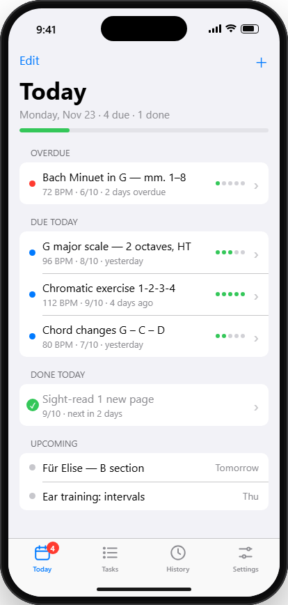
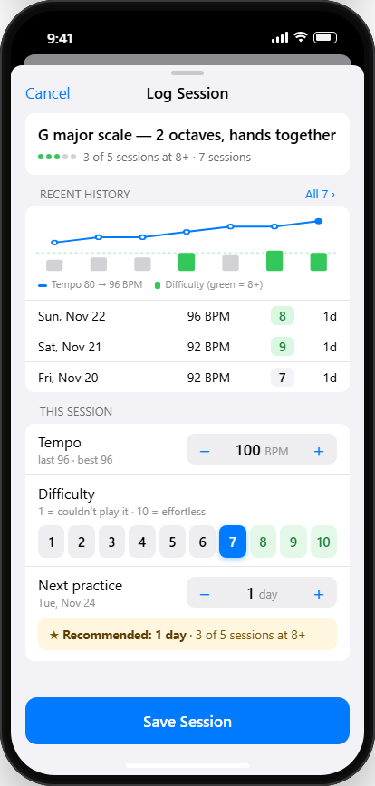
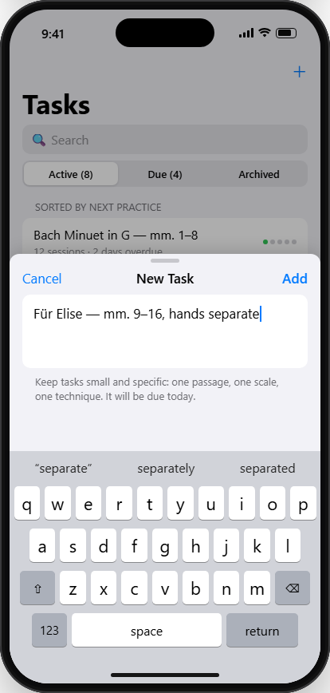
</p>

### Option B: Practice Mode *(best v0.3 add-on)*

A dark, guided flow: **Start** → one task at a time with a **built-in metronome** and timer → **rate it** → next task. The metronome tempo is logged automatically, so logging takes two taps.
The rating screen has big 1–10 buttons with a short description of each rating, an 8-session chart, and interval chips with a ★ on the recommended one. It also celebrates graduation (5th session at 8+).

<p>
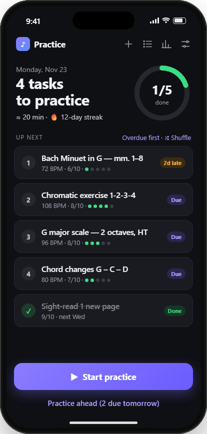
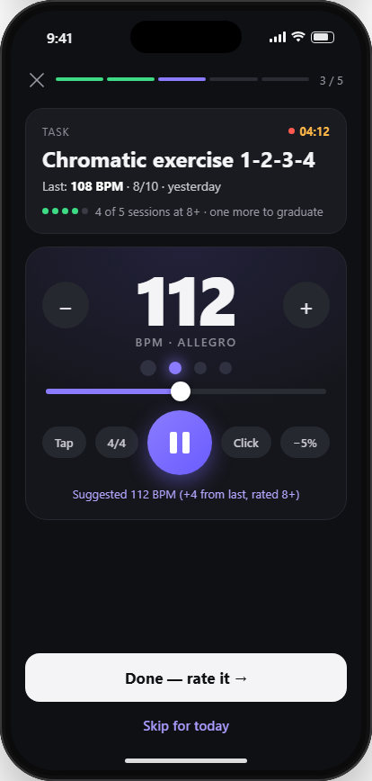
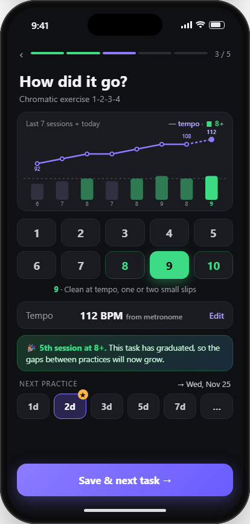
</p>

### Option C: Calendar Dashboard

A week strip with due counts per day (to spot heavy days), stat tiles, and cards with tempo sparklines. Each task has a full **detail page**: mastery progress, a tempo trend chart, difficulty bars with the 8+ line, and the session list. Logging happens in a compact sheet with the last 4 sessions shown as chips.

<p>
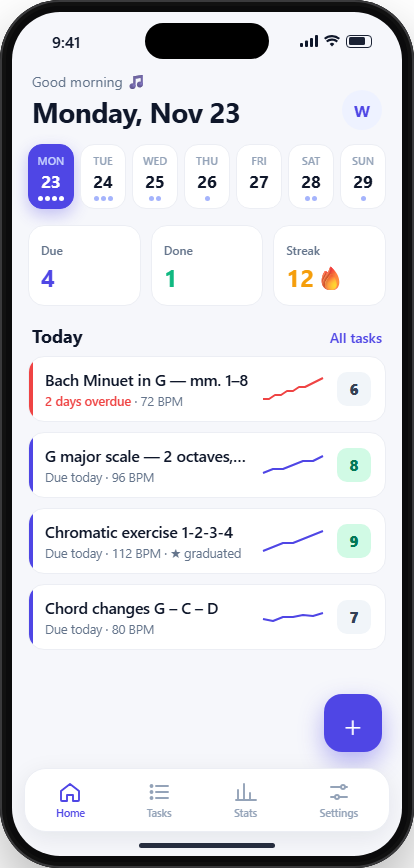
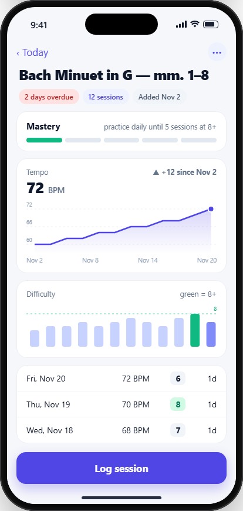
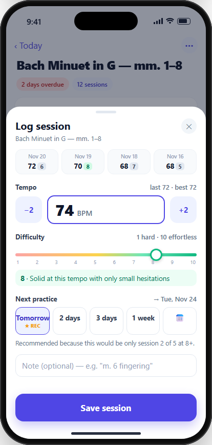
</p>

### Option D: Minimal Journal *(fastest to build)*

One scrolling page with no tabs and no modals. Rows expand in place to show a history table and a three-field form (Tempo · Diff · Days). It has a calm "paper notebook" look with serif headings and monospaced numbers.
D3 shows the **Settings & Backup** screen, which applies to whichever option you pick.

<p>
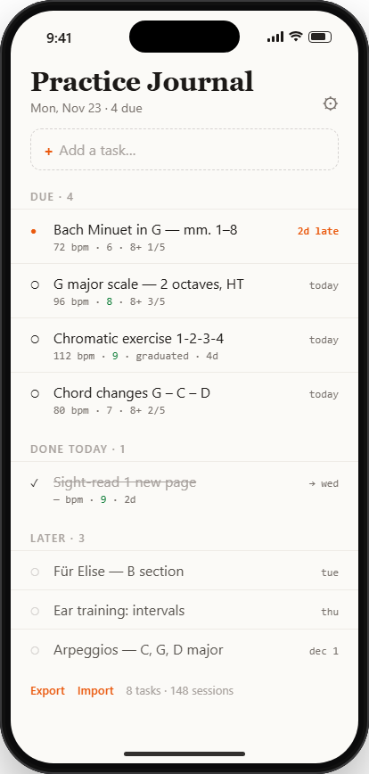
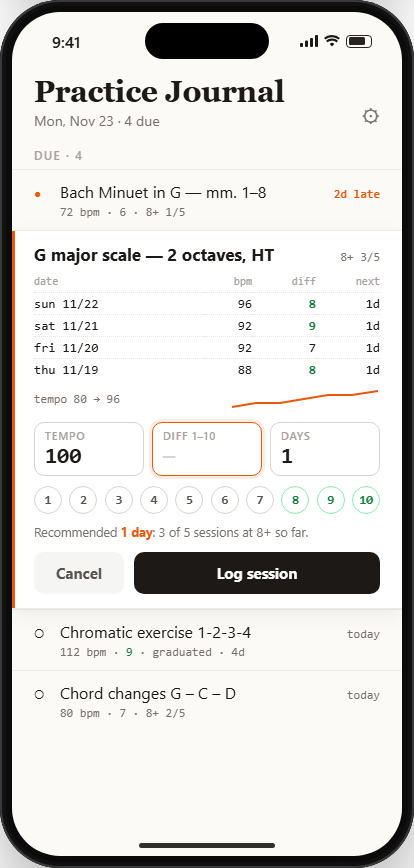
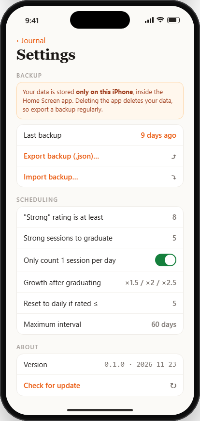
</p>

### Comparison

| | A · Native List | B · Practice Mode | C · Dashboard | D · Minimal |
|---|---|---|---|---|
| Taps to log (accepting prefills) | 3 | 2 | 3 | 3 |
| History while logging | Chart + last 3 | 8-session chart | Last 4 chips (charts on detail page) | Table + sparkline |
| Navigation | Tab bar + sheets | Linear flow | Floating tabs + detail pages | Single page |
| Build effort (MVP) | Medium | High | Medium-High | Low |

### Recommendation

Use **Option A as the app shell** (Today, Tasks, Log sheet, Settings). Borrow the **task detail page from C** in v0.2, and add **Practice Mode from B** (metronome, timer, rate-and-next) in v0.3. **D3's settings/backup screen** works with any option.
If you want something on your phone this week, **D** is the quickest MVP: the domain and data layers are identical, so the UI can be swapped later.

## 11. Testing strategy

| Layer | Tool | What | Status |
|---|---|---|---|
| Domain (pure) | **Vitest** | `strongStreak` (consecutive, one-per-day), `recommendInterval` (every row of the §4.4 table, reset, late/same-day base, clamping), `suggestTempo`, `buildToday` grouping/ordering, `practiceStreak`, date math across month/leap/DST boundaries, sample data consistent with the scheduler. | ✅ `npm test` |
| Data | Vitest (in-memory `Storage`) | Store actions (add/log/edit/delete/archive), due-date recomputation, persistence, unreadable-data handling, migrations/validation, backup round-trip, merge, invalid-file rejection, `isDesktop()` gating of Test mode. | ✅ `npm test` (40 tests total) |
| UI smoke | Browser walkthrough of the production build served under `/WkvPracticeApp/` | Test mode + date picker, sample data, logging through graduation → growth → reset, manual override, new/edit/archive/delete task, edit session, export, import (merge, replace, invalid), update prompt, offline reload with the server stopped, 375 px layout. | ✅ manual (automating it with Playwright WebKit is a future option) |
| Device | Manual checklist | Install from Pages URL, offline launch (airplane mode), update prompt after redeploy, safe areas/notch, keyboard behavior, dark mode, export to Files and re-import. | ⏳ after first deploy |

## 12. Roadmap

| Version | Scope |
|---|---|
| **v0.1** ✅ | Option A: Today queue, Tasks (search, Active/Due/Archived), Task detail with chart, History, Log Session with history and live recommendation, suggested tempo, notes, edit/delete sessions, archive, export/import, scheduler settings, backup reminder, light/dark, PWA install and offline, desktop Test mode |
| **v0.1.1** ✅ | New app icon (*03 Spaced Staff*), opt-in app icon badge with today's due count |
| **v0.2** | Snooze/skip ("not today" without logging), swipe-to-dismiss sheets |
| **v0.3** | Practice Mode (B): metronome with `audioSession` fix, tap tempo, timer, wake lock, interleaved queue |
| **later** | Tags/collections, target tempo per task, calendar heatmap, interval fuzzing/load balancing, IndexedDB if data grows |

## 13. Suggestions for a music spaced-repetition app

1. **Keep tasks small (chunking).** "Bach Minuet mm. 1–8" schedules far better than "Bach Minuet". Spaced repetition works best on items you can rate honestly in one go. Split hard passages into their own tasks.
2. **Anchor the rating scale** so "8" means the same thing every day. Show the anchor text under the picker:
   | Rating | Meaning |
   |---|---|
   | 10 | Effortless, performance-ready at this tempo |
   | 9 | Clean at tempo, one or two tiny slips |
   | 8 | Solid; small hesitations, no stops |
   | 6–7 | Got through it with several errors or hesitations |
   | 4–5 | Struggled; had to stop and restart |
   | 1–3 | Can't play it yet |
3. **Separate "how well" from "how fast".** A 9 at 60 BPM isn't a 9 at 120 BPM. Consider an optional **target tempo** per task. Show "% of target" and only count 8+ sessions *at or near target* toward graduation (a setting).
4. **Count at most one strong session per day.** The benefit comes from the spacing. Five good repetitions in one evening are still one day of memory. *(Implemented: the "One per day" setting, on by default.)*
5. **Make lapses visible.** With the consecutive rule, a single bad day on a graduated piece puts it back on daily practice. That's strict but honest, and the Log sheet says so before you save ("below 8 ends the 6-session streak"). If it turns out too punishing, a future setting could allow one "grace" session.
6. **Make logging near-zero effort:** tempo prefilled (suggested), rating one tap, days prefilled with the recommendation. Friction is the #1 reason practice logs get abandoned.
7. **Show the last note when you start a task** ("m. 6: use 3rd finger"). It's the most useful bit of history, and cheap to add.
8. **Interleave.** Mixing tasks in one session (rather than finishing one, then the next) tends to improve long-term retention of motor skills. Practice Mode can shuffle the due queue.
9. **Keep the queue humane.** Cap the daily list (e.g. a 20-minute budget), let overdue tasks spill over without guilt, and offer *practice ahead* for tomorrow's tasks on a free day.
10. **Add some randomness to long intervals** (±10%) so tasks that graduated together don't keep landing on the same day. The week strip in Option C makes the workload visible.
11. **Daily "maintenance" tasks** (warm-ups, scales) can be a task type that's always due and is excluded from graduation.
12. **Retire, don't delete.** Archive mastered pieces (or put them on a 60–90-day "maintenance" interval) so the history is kept.
13. **Back up.** Data lives only on the phone, so a monthly export to iCloud Drive via the share sheet is cheap insurance.
14. **Record yourself (outside the app).** Hearing a recording is the best way to rate honestly. Voice Memos is fine; the app could later add a link per session.
15. **Track the `recommendedDays` vs `intervalDays` you choose.** If you keep overriding the recommendation in the same direction, the growth factors need tuning, and you'll have the data to do it.

## 14. Open questions

Resolved: rating direction (10 = best), consecutive 8+ streak, design Option A, follow-the-system theme (overridable in Settings), and a relative `base` so the repo name doesn't matter.

1. **After graduation:** are the growth factors (×1.5 / ×2 / ×2.5, 2–60 days) right for you? All of them can be changed in Settings.
2. **Tempo:** should there be an optional target tempo per task?
3. **Instrument(s):** affects examples and future metronome features (time signatures, subdivisions, accent patterns).
4. **Repo visibility:** public repo (free Pages) or private (paid plan)?
